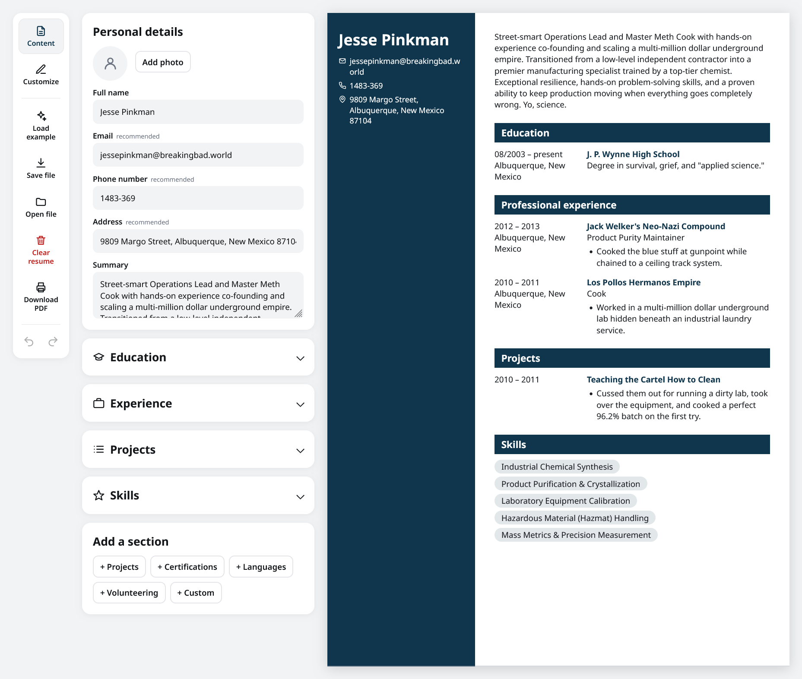

# CV Application

A resume builder that runs in your browser, built with React and Vite. You fill in a form on the left and the resume renders live on the right. The app saves your work to localStorage.

## Features

- Sections for personal details, education, experience, skills, and custom sections you add yourself.
- Style controls for template, layout, accent color, font, and text size.
- Undo and redo, wired to Ctrl/Cmd+Z and Ctrl/Cmd+Shift+Z.
- Export your resume as JSON and import it again later; saves from the older format migrate on load.
- Download PDF opens your browser's print dialog on the resume.
- Email, phone, and date fields show format hints while you type, and never block editing.
- An example resume loads on first visit, so the preview is never empty.

**[Live Demo](https://cv-application-w3nc.vercel.app/)**

